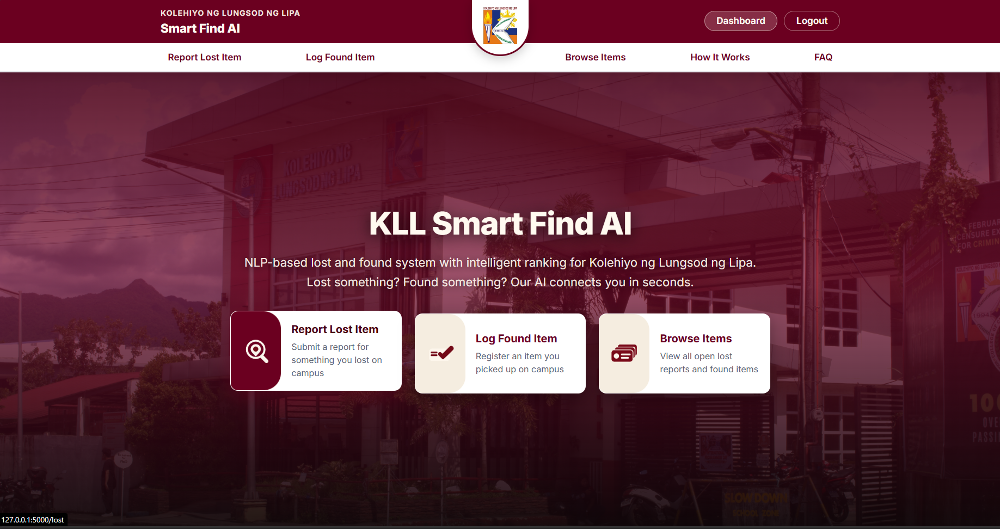
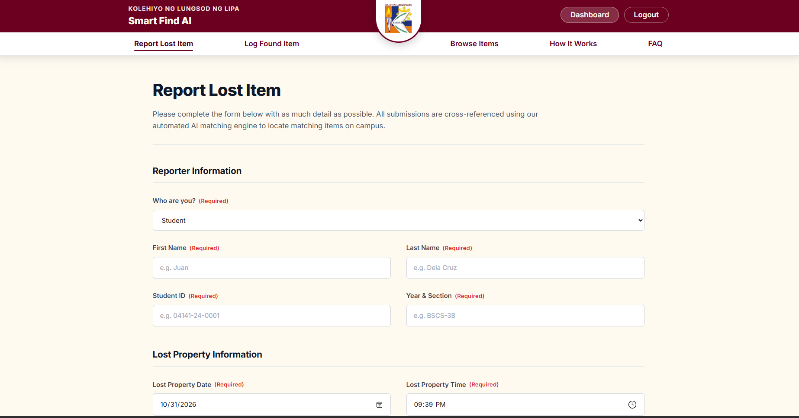
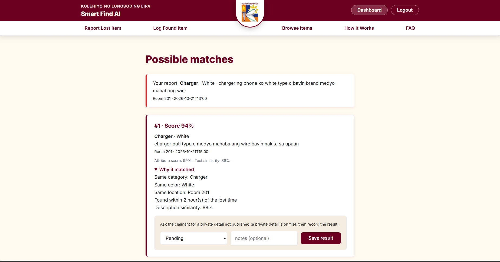

# KLL Lost and Found

An NLP-based lost-and-found matching system with intelligent ranking for **Kolehiyo ng Lungsod ng Lipa (KLL)**. Built for **CSE 103 Intelligent System**.

Someone reports a lost item, staff log a found item, and the system suggests the most likely matches using a hybrid AI score. Staff verify the owner before releasing the item.

## Screenshots

| Home | Report a lost item | Possible matches |
| --- | --- | --- |
|  |  |  |

## Quick start (Windows)

You need **Python 3.13** and **Git**. See [SETUP.md](SETUP.md) for full instructions.

```
mkdir C:\dev
cd C:\dev
git clone https://github.com/Ceihiro/kll-lost-and-found.git
cd kll-lost-and-found
python -m venv venv
venv\Scripts\activate
pip install -r requirements.txt
python seed_data.py
python app.py
```

Open **http://127.0.0.1:5000** in your browser. Press **Ctrl + C** to stop.

Every time you come back: `cd C:\dev\kll-lost-and-found`, `venv\Scripts\activate`, `git pull`, `python app.py`.

## How the matching works

Each found item gets two scores, mixed 50/50 (adjustable in `config.py`):

| Score | Method | How |
|---|---|---|
| **Attribute score** | Rule-based | Compares category, color, brand, location, and time. Blank fields are skipped and the remaining weights are rescaled. |
| **Text score** | NLP (AI) | TF-IDF vectorization + cosine similarity on the description text, using scikit-learn. |

The top 3 matches are shown with the reasons for each. Weights are in `config.py`.

### Accuracy results (evaluated on 20 lost / 25 found reports)

| Method | Top-1 | Top-3 |
|---|---|---|
| Attribute only | 100% | 100% |
| Text only | 85% | 100% |
| **Combined** | **100%** | **100%** |

Text-only misses 3 out of 20 at top-1 because Taglish descriptions (e.g. *payong*, *tumbler*, *may sticker*) reduce cosine similarity when wording differs between the lost and found reports. The combined method catches all 20.

## Pages

| URL | Who | What |
|---|---|---|
| `/` | Public | Home — open lost reports and found items |
| `/lost` | Public | Report a lost item |
| `/found` | Public | Log a found item |
| `/matches/<id>` | Public | Top matches for a lost report |
| `/staff/login` | Staff | Login page |
| `/staff/logout` | Staff | Clears the session |
| `/staff/dashboard` | Staff only | All items, overdue reminders, claim history |
| `/staff/export` | Staff only | Download all items as CSV |
| `/claim` | Staff only | Record a verification outcome |

## Files

| File | What it does | Role |
|---|---|---|
| `app.py` | All URL routes and form handling | Backend coder |
| `db.py` | SQLite database — items and claims tables | Database designer |
| `matching.py` | Attribute score + TF-IDF ranking | NLP / AI reviewer |
| `config.py` | Categories, rooms, colors, weights | Everyone |
| `evaluate.py` | Accuracy benchmark (top-1 / top-3) | Tester / QA |
| `data/` | Test CSV files for evaluate.py | Data collector |
| `templates/` | HTML page templates | UI/UX reviewer |
| `static/style.css` | Page styles | UI/UX reviewer |
| `seed_data.py` | Loads sample data into the database | — |
| `test.py` | Quick library check after setup | — |

## Security notes

- `SECRET_KEY` and staff credentials are in `.env` (never committed to GitHub).
- Every form is protected by a CSRF token (Flask-WTF).
- The `/claim`, `/staff/dashboard`, and `/staff/export` routes require staff login.

## Still to build

- Feedback buttons that adjust the matching weights based on staff corrections
- Mobile-friendly UI redesign
